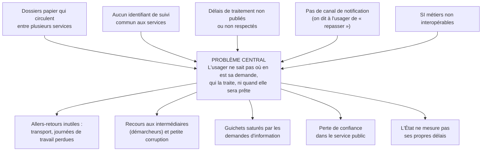

# 01 — Études (problème, marché, benchmark, personas, recherche utilisateur)

**Startup : SUIVO** — *« Votre dossier administratif, suivi comme un colis. »*
Critères du jury servis : pertinence et impact citoyen, viabilité.

> Convention : les chiffres marqués **[H]** sont des hypothèses de travail à valider pendant la phase de découverte (méthode indiquée). Les autres viennent de l'observation terrain ou de la description officielle de la problématique.

---

## 0. Nom et promesse

| Proposition | Sens | Note |
|---|---|---|
| **SUIVO** (retenu) | « suivi » + « vo » (vos dossiers) ; court, prononçable dans toutes les langues | Vérifier `suivo.ci` auprès de l'ARTCI/NIC.ci |
| DOSSIA | « dossier » + IA | Risque de confusion avec un produit d'IA |
| TRAKA | « track », sonorité locale | Peu explicite pour le grand public |

**Elevator pitch (30 s)** — *Chaque année, des millions d'Ivoiriens font plusieurs allers-retours au guichet juste pour savoir « où en est mon dossier ». SUIVO relie les services qui traitent une demande et montre à l'usager, comme pour un colis, l'étape en cours, le service responsable et le délai restant, par appli, SMS ou WhatsApp. Pour l'administration, c'est un tableau de bord qui mesure enfin les délais réels et repère les blocages. Gratuit pour le citoyen, vendu en SaaS aux administrations.*

---

## 1. Analyse du problème

### 1.1 Arbre à problèmes

### 1.2 Coût du statu quo (par demande) — [H] à valider par 30 entretiens et 200 questionnaires

| Poste | Hypothèse | Coût |
|---|---|---|
| Déplacements « pour rien » | 2,5 allers-retours en moyenne | — |
| Transport (Abidjan, aller-retour woro-woro/gbaka) | 1 000 FCFA × 2,5 | 2 500 FCFA |
| Temps perdu | 3 h par déplacement × 2,5 = 7,5 h ; valorisé au SMIG (75 000 FCFA/mois ≈ 430 FCFA/h) | ≈ 3 200 FCFA |
| Intermédiaire informel (si recours, 25 % des cas [H]) | 5 000 FCFA × 25 % | 1 250 FCFA |
| **Total par demande** | | **≈ 7 000 FCFA** |

À l'intérieur du pays, le coût de transport peut être 3 à 5 fois plus élevé (déplacement vers le chef-lieu de région ou Abidjan).

Côté administration [H] : 30 à 50 % des passages au guichet sont des demandes d'information sur l'état d'un dossier. Chaque passage évité libère du temps d'agent pour le traitement.

---

## 2. Étude de marché

### 2.1 Volume (unité = demande administrative suivie)

| Niveau | Définition | Calcul [H] | Volume / an |
|---|---|---|---|
| **TAM** | Toutes les démarches administratives à plusieurs étapes en Côte d'Ivoire | ~30 M d'habitants × 1,0 démarche/an | ≈ 30 M |
| **SAM** | Démarches à plusieurs étapes dans les 201 communes + grands organismes, usagers joignables par mobile (SMS inclus) | 40 % du TAM | ≈ 12 M |
| **SOM (36 mois)** | 3 procédures pilotes étendues à 25 communes + 2 organismes nationaux | — | ≈ 1,2 M |

### 2.2 Valeur (FCFA)

| Segment | Hypothèse de prix | Clients cibles à 36 mois | Revenu annuel |
|---|---|---|---|
| B2G — licence SaaS commune | 3 M FCFA/an (petite) à 12 M (grande) | 25 communes | ≈ 150 M |
| B2G — organisme/ministère | 25 à 60 M FCFA/an + intégration | 2 | ≈ 90 M |
| B2B2C — services premium (RDV, livraison, relance prioritaire) | 500 à 2 000 FCFA ; 4 % des usagers | 48 000 transactions | ≈ 50 M |
| B2B — API vérification de statut (banques, notaires, RH) | 100 FCFA/appel | 300 000 appels | ≈ 30 M |

Le détail est dans le modèle financier (livrable 07).

### 2.3 Facteurs favorables
- Stratégie nationale de développement du numérique et volonté politique de dématérialisation des services publics (thème même des JNSP).
- Taux de pénétration mobile supérieur à 100 % ; WhatsApp très utilisé ; Mobile Money massif (Orange, MTN, Moov, Wave).
- Préexistence de plateformes de dépôt en ligne : SUIVO se positionne en **couche de suivi transversale**, pas en concurrent.

---

## 3. Benchmark

| Solution | Pays | Ce qu'elle fait bien | Limite | Leçon pour SUIVO |
|---|---|---|---|---|
| Portails e-gouv nationaux et plateformes sectorielles | Côte d'Ivoire | Dépôt en ligne de certaines démarches, paiement | Suivi limité à chaque plateforme, peu de visibilité inter-services | Se brancher dessus par API plutôt que les remplacer |
| **Irembo** | Rwanda | Guichet unique, paiement mobile, agents assistés dans les villages | Long à construire, nécessite un mandat fort de l'État | Le **réseau d'agents assistés** est clé pour les non connectés |
| e-Estonia / X-Road | Estonie | Interopérabilité native, l'usager voit qui a consulté ses données | Prérequis d'identité numérique et d'infrastructure | Viser l'**interopérabilité par API** dès le jour 1 |
| UMANG | Inde | Une appli pour des centaines de services, multilingue | Expérience hétérogène selon les services | Le **multilinguisme** et une UX homogène comptent |
| Suivi de colis (DHL, La Poste…) | Monde | Modèle mental universel : numéro + timeline + notifications | — | Copier le **paradigme du colis** : c'est notre interface |
| Watiqa / portails marocains | Maroc | Commande d'actes en ligne et livraison | Périmètre restreint à l'état civil | Le **service de livraison** est un revenu premium crédible |

**Positionnement** : SUIVO n'est pas un nouveau portail de dépôt. C'est l'**infrastructure de traçabilité** qui donne un numéro de suivi unique à toute demande (déposée en ligne ou au guichet) et la fait progresser entre services, avec des SLA visibles.

---

## 4. Personas

| | **Awa, 29 ans** — citoyenne urbaine connectée | **Konan, 52 ans** — planteur, Daloa | **Mme Bamba, 41 ans** — agente de guichet, mairie | **M. Kouadio, 55 ans** — secrétaire général de mairie |
|---|---|---|---|---|
| Contexte | Commerciale à Yopougon, smartphone Android, WhatsApp | Téléphone basique, lit peu le français, parle baoulé | Reçoit 80 usagers/jour, registre papier | Rend compte au maire et à la tutelle |
| Job-to-be-done | « Obtenir mon certificat de nationalité pour un concours sans perdre de jours de travail » | « Obtenir l'acte de naissance de mon fils pour l'école sans aller trois fois en ville » | « Répondre vite aux usagers et avoir moins de monde devant mon guichet » | « Savoir où ça bloque et montrer que mon service est performant » |
| Frustrations | « Revenez la semaine prochaine » ; aucune date ; démarcheurs | Coût du transport, dépend de ses enfants pour lire | Questions répétitives ; outils lents ; peur d'être surveillée | Aucune donnée sur les délais ; plaintes ; pression politique |
| Gains attendus | Notification « prêt à retirer », délai affiché | SMS en langue simple / appel vocal ; un agent relais au village | Moins de passages « pour info » ; mise à jour en 1 clic | Tableau de bord des SLA ; classement entre services |
| Canal | PWA + WhatsApp | USSD / SMS / guichet assisté | Tableau de bord web (PC ou tablette) | Tableau de bord + rapport mensuel PDF |

---

## 5. Plan de recherche utilisateur (phase de découverte, 3 semaines)

### 5.1 Guide d'entretien usager (30 min, 10 questions)
1. Racontez-moi la dernière démarche administrative que vous avez faite, du début à la fin.
2. Combien de fois êtes-vous allé·e sur place ? Pour quoi faire à chaque fois ?
3. Comment saviez-vous où en était votre dossier ?
4. Combien cela vous a-t-il coûté (transport, temps, autres frais) ?
5. Avez-vous fait appel à quelqu'un pour vous aider ou accélérer ? Pourquoi ?
6. Quel a été le moment le plus frustrant ?
7. Si vous pouviez recevoir une information automatiquement, laquelle et par quel canal ?
8. Seriez-vous prêt·e à payer pour un service (livraison, rendez-vous) ? Combien ?
9. Qui, dans votre entourage, aurait encore plus de difficultés que vous ?
10. Montrez-moi votre téléphone : quelles applis utilisez-vous tous les jours ?

### 5.2 Guide d'entretien agent / chef de service (45 min)
Volume quotidien, part des demandes d'information, outils utilisés, étapes et services traversés par un dossier, délais réels vs théoriques, causes de blocage, appréhensions vis-à-vis de la traçabilité, conditions d'adoption (formation, matériel, reconnaissance).

### 5.3 Questionnaire quantitatif (n ≥ 200, en ligne + face à face devant 5 mairies)
Démarche, nombre de déplacements, coût estimé, canal préféré (SMS / WhatsApp / appli / appel), intérêt (échelle 1–5), disposition à payer par service premium, équipement (smartphone / basique), langue préférée.

### 5.4 Test d'utilisabilité du prototype (n = 8 par vague, 2 vagues)
Tâches : (1) suivre un dossier avec un numéro, (2) déposer une demande, (3) répondre à une demande de pièce manquante, (4) côté agent, faire avancer un dossier.
**Critères de succès** : ≥ 85 % de réussite sans aide ; tâche 1 en < 30 s ; SUS ≥ 75.

### 5.5 Indicateurs de validation (go / no-go du pilote)

| Hypothèse | Seuil de validation |
|---|---|
| L'usager fait ≥ 2 déplacements inutiles par demande | Médiane ≥ 2 sur l'échantillon |
| L'usager veut être notifié par SMS/WhatsApp | ≥ 70 % |
| L'agent accepte de mettre à jour le statut s'il prend < 10 s | ≥ 6 agents sur 8 lors du test |
| Une mairie accepte un pilote gratuit de 3 mois | Lettre d'intention signée |

---

## 6. PESTEL

| Facteur | Constat | Impact |
|---|---|---|
| **P**olitique | Modernisation de l'administration prioritaire ; JNSP comme vitrine | ++ sponsor institutionnel possible |
| **É**conomique | Budgets publics contraints ; délais de paiement de l'État | — prévoir trésorerie + financements bailleurs |
| **S**ocial | Jeunesse connectée ; illettrisme partiel ; méfiance envers l'administration | + adoption rapide en ville ; prévoir canaux assistés |
| **T**echnologique | 4G urbaine, 2G/3G rurale ; Android d'entrée de gamme | PWA légère, offline-first, SMS/USSD |
| **E**nvironnemental | Moins de déplacements = moins d'émissions ; moins de papier | + argument RSE / bailleurs |
| **L**égal | Loi 2013-450 (données personnelles, ARTCI) ; marchés publics | Déclaration ARTCI, DPO, minimisation des données |

## 7. SWOT

| Forces | Faiblesses |
|---|---|
| Modèle mental simple (« comme un colis ») ; gratuit pour l'usager ; complémentaire de l'existant ; stack légère | Dépend de la mise à jour par les agents ; pas encore de référence client ; équipe jeune |
| **Opportunités** | **Menaces** |
| Volonté politique ; bailleurs (Banque mondiale, BAD, UE, GIZ) qui financent le GovTech ; extension UEMOA | Cycles de décision publics longs ; résistance au changement ; solution concurrente imposée par l'État ; cybersécurité |

## Risques & hypothèses critiques
1. **Adoption agent** — mitigée par une mise à jour en 1 clic/scan de QR, un classement des services et la formation sur site.
2. **Paiement public lent** — mitigé par le financement bailleurs/subventions et les revenus B2B2C.
3. **Données** — conformité ARTCI dès le pilote.

## Prochaine action en 48 h
Obtenir un rendez-vous avec le secrétaire général de la mairie de Yopougon et faire 10 entretiens usagers devant l'état civil.
