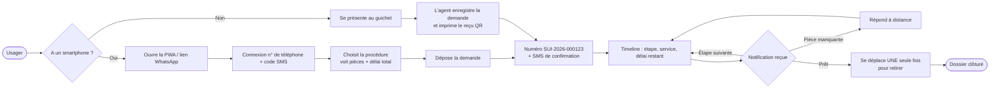
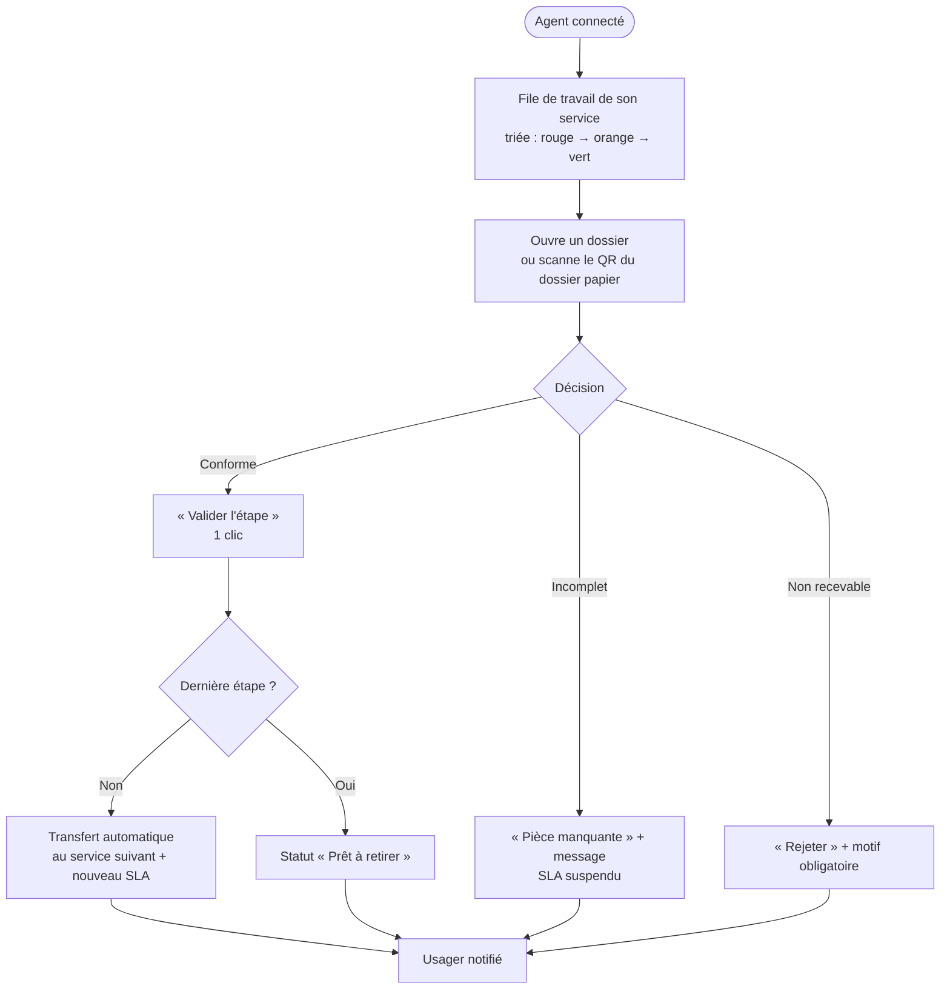
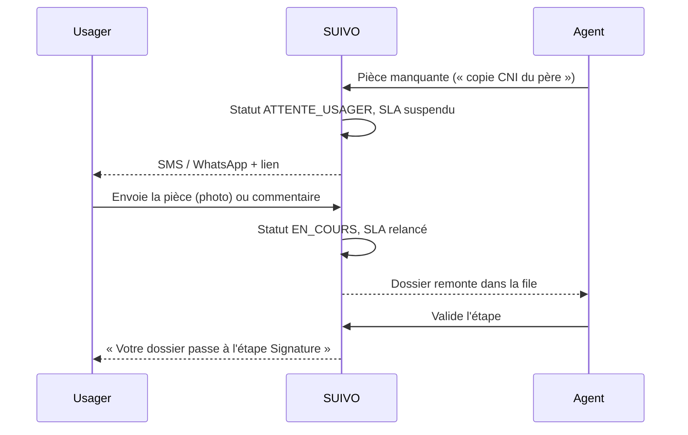
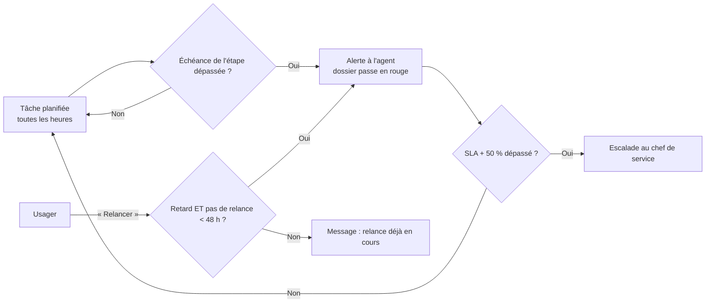
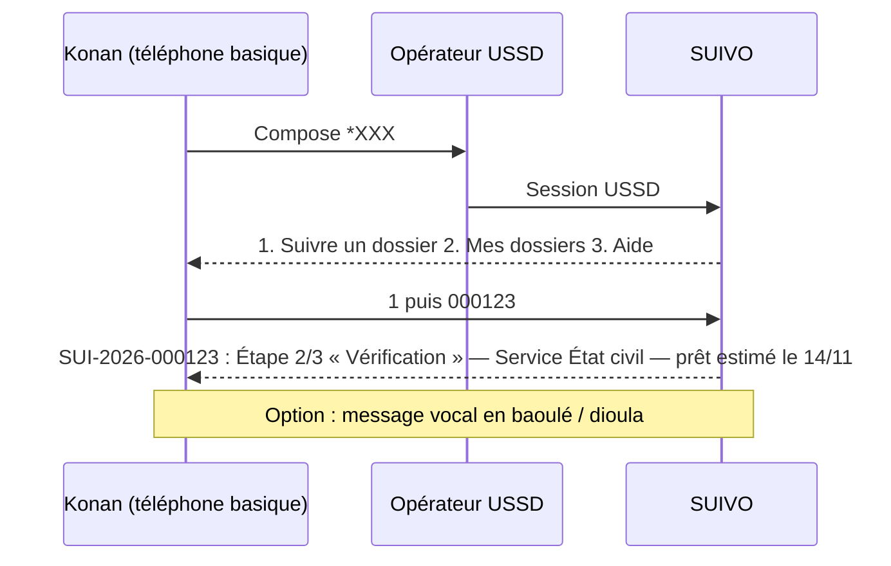
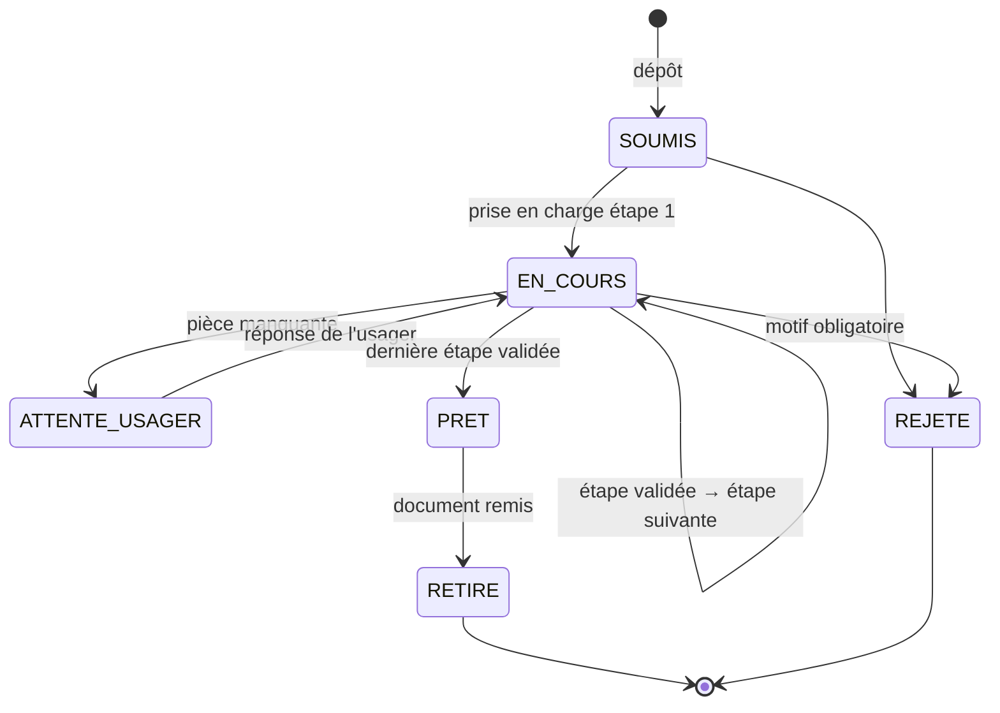
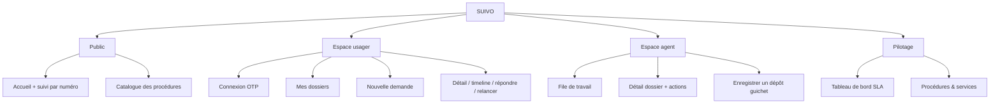

# 05 — User workflows

Critères du jury servis : pertinence, faisabilité. Les diagrammes Mermaid s'affichent directement sur GitHub.

## (a) Dépôt et suivi par l'usager

## (b) Traitement par l'agent

## (c) Pièce manquante et reprise

## (d) Relance automatique et escalade sur dépassement de SLA

## (e) Parcours sans smartphone (USSD / SMS)

## (f) Machine à états d'une demande

## Arborescence de l'application

## Risques & hypothèses critiques
1. **Parcours réel ≠ parcours modélisé** : les étapes et services des procédures ont été reconstitués et doivent être confirmés par chaque administration. *Validation* : suivre physiquement 5 dossiers de bout en bout (« shadowing »).
2. **Pièce manquante à distance** : certaines pièces doivent être présentées en original. Le parcours doit alors proposer un rendez-vous plutôt qu'un envoi en ligne.
3. **USSD** : la session est limitée à environ 180 secondes et 182 caractères par écran ; chaque écran doit tenir dans cette limite.

## Prochaine action en 48 h
Dérouler le parcours (a) avec 3 usagers sur papier (maquettes imprimées) et noter chaque hésitation.
