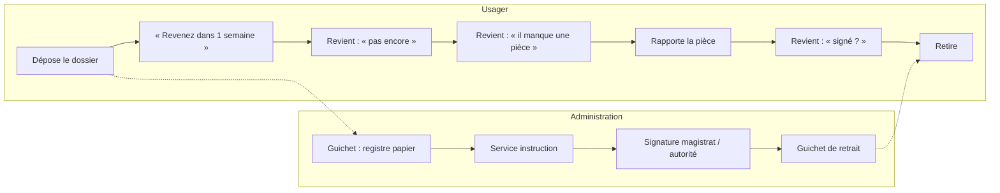
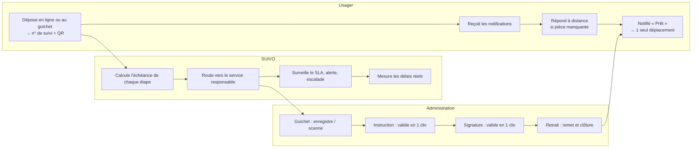

# 06 — Élaboration du processus (AS-IS → TO-BE)

Critères du jury servis : impact, faisabilité, passage à l'échelle.
Exemple de référence : **certificat de nationalité** (procédure multi-acteurs fréquente chez les candidats aux concours).

## 1. AS-IS — processus actuel (observé / à confirmer en découverte)

**Constats** : 4 à 5 déplacements, aucune date engageante, la pièce manquante n'est découverte qu'au déplacement suivant, aucune mesure du temps passé à chaque étape, le dossier peut « dormir » sur un bureau sans que personne ne le sache.

## 2. TO-BE — processus cible avec SUIVO

## 3. Gains attendus [H — mesurés pendant le pilote]

| Indicateur | AS-IS | TO-BE | Gain |
|---|---|---|---|
| Déplacements par demande | 4–5 | 2 (dépôt + retrait), 1 si dépôt en ligne | −60 % à −80 % |
| Coût usager par demande | ≈ 7 000 FCFA | ≈ 2 000 FCFA | −70 % |
| Passages « pour information » au guichet | 30–50 % du flux | < 10 % | Guichet désengorgé |
| Délai de détection d'une pièce manquante | au prochain passage (≈ 7 j) | immédiat | −7 jours |
| Visibilité du délai réel par étape | aucune | 100 % des dossiers | Pilotage possible |

## 4. Modèle de SLA (paramétrable par administration)

| Procédure | Étape | Service responsable | SLA |
|---|---|---|---|
| Extrait d'acte de naissance | 1. Recherche registre | État civil — mairie | 1 j |
| | 2. Signature officier d'état civil | Cabinet du maire | 1 j |
| Certificat de nationalité | 1. Réception et contrôle des pièces | Greffe — tribunal | 2 j |
| | 2. Instruction | Service nationalité | 5 j |
| | 3. Signature | Président du tribunal / juge | 3 j |
| Casier judiciaire (bulletin n° 3) | 1. Recherche | Greffe | 2 j |
| | 2. Délivrance | Greffe | 1 j |
| Permis de construire | 1. Recevabilité | Guichet urbanisme | 5 j |
| | 2. Instruction technique | Direction de l'urbanisme | 20 j |
| | 3. Avis services concernés | Services techniques | 15 j |
| | 4. Signature | Autorité compétente | 5 j |

> Les SLA ci-dessus sont des **valeurs de départ** ; ils sont fixés avec chaque administration et ajustés à partir des délais réels mesurés (médiane sur 90 jours).

**Règles** : SLA en jours ouvrés • suspendu pendant `ATTENTE_USAGER` • orange à 80 % consommé • rouge au dépassement • escalade au N+1 à 150 % • relance usager autorisée seulement en retard, 1 fois / 48 h.

## 5. Matrice RACI

| Activité | Usager | Agent guichet | Agent instructeur | Chef de service | Admin SUIVO (administration) | Équipe SUIVO |
|---|---|---|---|---|---|---|
| Déposer la demande | R | R (dépôt guichet) | — | — | — | — |
| Modéliser la procédure et les SLA | — | C | C | A | R | C |
| Mettre à jour l'étape | I | R | R | A | — | — |
| Demander une pièce manquante | I | R | R | A | — | — |
| Traiter une escalade | I | — | C | R/A | I | — |
| Publier le tableau de bord | — | — | — | I | A | R |
| Former les agents | — | I | I | A | C | R |
| Disponibilité, sécurité, conformité | — | — | — | I | C | R/A |

R = Réalise, A = Approuve, C = Consulté, I = Informé.

## 6. Conduite du changement côté administration

1. **Sponsor** : note de service du ministère / du maire rendant la mise à jour obligatoire sur les procédures pilotes.
2. **Agents champions** : 1 par service, formés en premier, reconnus publiquement (prix JNSP interne « service le plus réactif »).
3. **Zéro effort supplémentaire** : action en 1 clic ou scan de QR ; tablettes fournies pendant le pilote si besoin.
4. **Mesurer pour valoriser** : tableau de bord affiché ; on compare un service à lui-même (progression), pas seulement aux autres.
5. **Formation** : 2 h sur site + vidéos de 2 min en français/dioula + support WhatsApp.
6. **Boucle de retour** : rétrospective mensuelle avec les agents ; leurs demandes priorisées dans le backlog.

## 7. Stratégie d'intégration aux systèmes existants

| Niveau | Quand | Comment |
|---|---|---|
| 0 — Autonome | Pilote, administration sans SI | Les agents utilisent directement l'interface SUIVO |
| 1 — Mode dégradé assisté | SI existant non ouvert | Saisie rapide / scan QR, double saisie minimale |
| 2 — Connecteur | SI avec base accessible | Connecteur qui lit les changements d'état et les publie dans SUIVO |
| 3 — API / Webhooks | Plateformes modernes | SUIVO expose `POST /events` ; les plateformes de dépôt envoient les événements, SUIVO notifie |

## 8. Sécurité et conformité
- Déclaration auprès de l'ARTCI, désignation d'un DPO, registre des traitements.
- Données minimales : téléphone, nom, type de procédure ; **aucune pièce sensible stockée dans le MVP**.
- Suivi public par numéro : nom masqué (initiales), aucune donnée sensible.
- Journal d'audit immuable de chaque action ; chiffrement TLS ; sauvegardes quotidiennes ; hébergement local envisagé.

## Risques & hypothèses critiques
1. **SLA de départ** : les délais du tableau §4 sont des valeurs initiales, pas des engagements officiels. *Parade* : les fixer avec chaque chef de service, puis les ajuster à partir des médianes réelles.
2. **Gains annoncés** : les −60 à −80 % de déplacements sont une hypothèse. *Mesure* : enquête avant/après auprès de 100 usagers du pilote.
3. **Résistance au changement** : la traçabilité peut être perçue comme de la surveillance. *Parade* : présenter les indicateurs par service (et non par agent) pendant le pilote, et valoriser la progression.

## Prochaine action en 48 h
Cartographier en personne le parcours AS-IS du certificat de nationalité au tribunal pilote : qui touche le dossier, combien de temps, où il attend.
