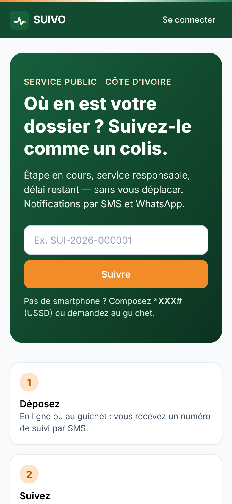
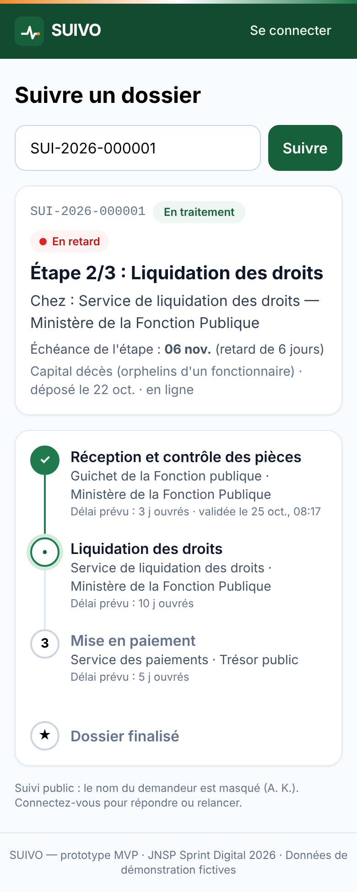
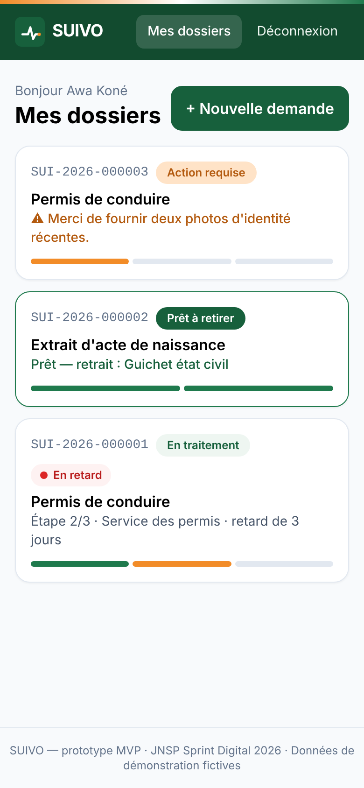
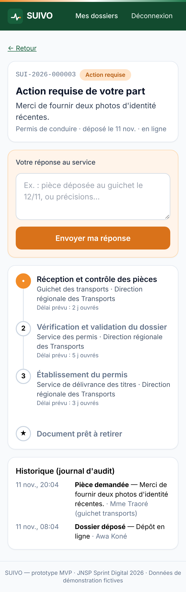
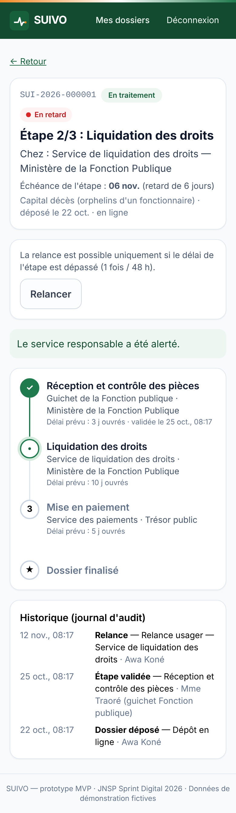
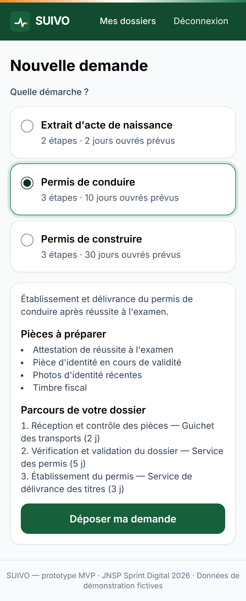
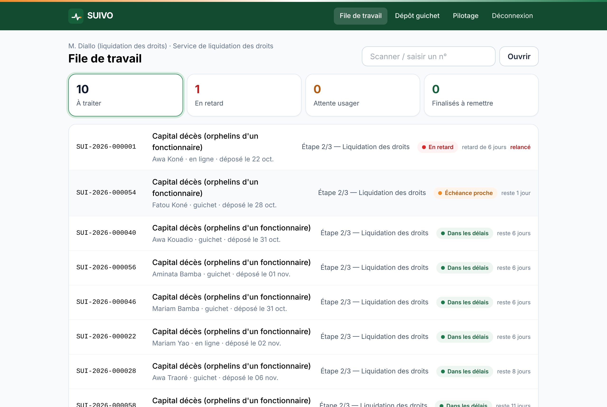
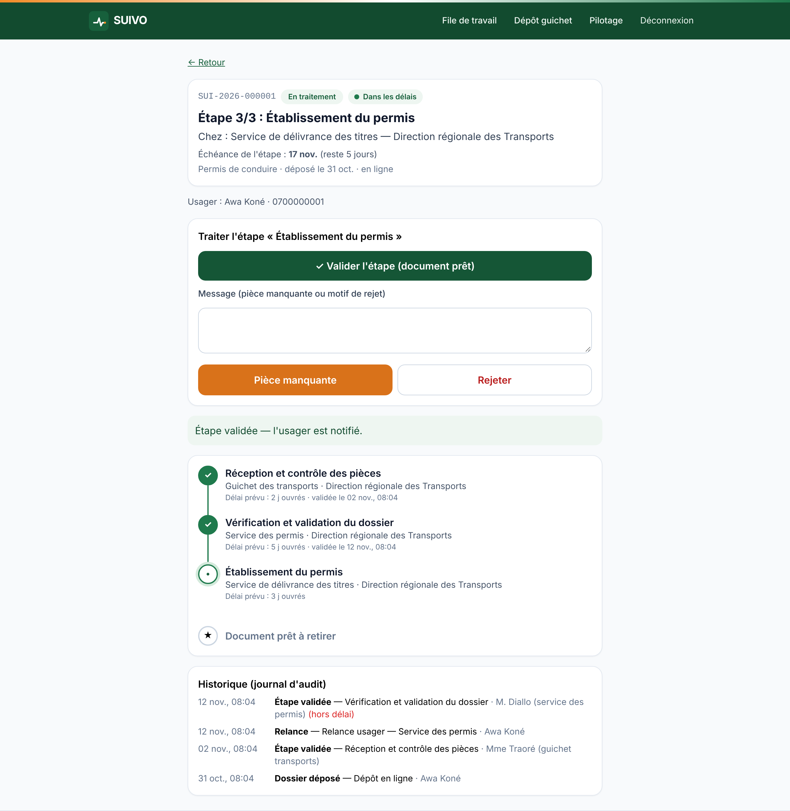
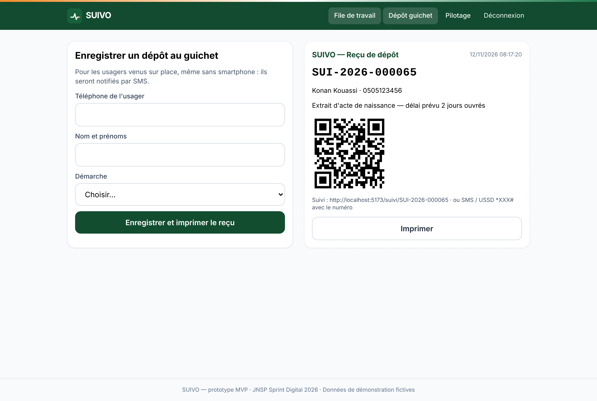
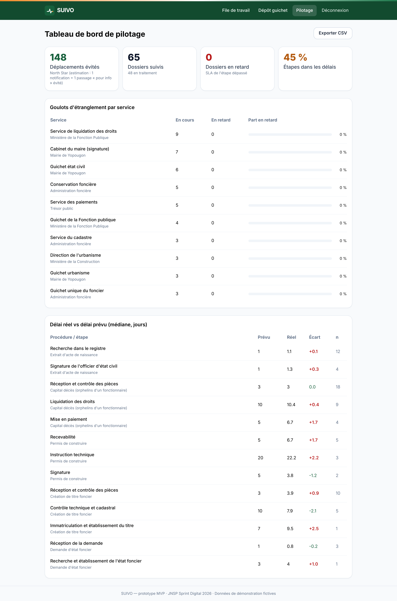

# 09 — Maquettes, prototype et charte graphique

Critères du jury servis : innovation, qualité de l'expérience, faisabilité.

> **Prototype cliquable = le MVP lui-même** (dossier [`mvp/`](./mvp)). Plutôt que de produire des maquettes figées puis de les recoder, nous avons conçu les écrans directement dans le code React + Tailwind, ce qui garantit que chaque maquette est réellement implémentable. Les captures ci-dessous sont tirées de l'application en fonctionnement, à partir des données de démonstration.

## 1. Zoning des écrans clés

```
┌──────────── Mobile usager : « Suivi » ─────────────┐   ┌──────────────── Desktop agent : « File de travail » ─────────────────┐
│ [Logo SUIVO]                       [Se connecter]  │   │ [Logo]           File · Dépôt guichet · Pilotage · Déconnexion        │
│ Titre : Suivre un dossier                          │   │ Agent · Service                           [Scanner / n°] [Ouvrir]     │
│ [ n° de dossier ............ ] [Suivre]            │   │ ┌─À traiter─┐┌─En retard─┐┌─Attente usager─┐┌─Prêts à remettre─┐  │
│ ┌ RÉSUMÉ (réponse en 3 s) ───────────────────────┐ │   │ └───────────┘└───────────┘└────────────────┘└──────────────────┘  │
│ │ n° · [Statut] · [● Niveau SLA]                 │ │   │ ┌ Liste triée : rouge → orange → vert ──────────────────────────┐   │
│ │ Étape 2/3 : <nom de l'étape>                   │ │   │ │ n° · procédure · usager · canal · étape · [badge] · délai     │   │
│ │ Chez : <service> — <organisme>                 │ │   │ └───────────────────────────────────────────────────────────────┘   │
│ │ Échéance : <date> (reste / retard de N j)      │ │   └──────────────────────────────────────────────────────────────────────┘
│ └────────────────────────────────────────────────┘ │
│ ┌ TIMELINE verticale ────────────────────────────┐ │   Détail agent : Résumé → [✓ Valider l'étape] (bouton principal, pleine
│ │ ✓ Étape 1 · service · validée le …             │ │   largeur) → message → [Pièce manquante] [Rejeter] → Timeline → Historique
│ │ ● Étape 2 · service · délai prévu              │ │
│ │ ○ Étape 3                                      │ │
│ │ ★ Document prêt à retirer                      │ │
│ └────────────────────────────────────────────────┘ │
└────────────────────────────────────────────────────┘
```

## 2. Écrans haute fidélité (captures du MVP)

| Écran | Capture |
|---|---|
| Accueil mobile : suivi par numéro, démarches |  |
| Suivi public : étape, service, retard |  |
| Mes dossiers (barre de progression par étape) |  |
| Action requise : pièce manquante, réponse à distance |  |
| Relance d'un dossier en retard |  |
| Nouvelle demande : pièces et parcours affichés avant le dépôt |  |
| File de travail de l'agent |  |
| Validation d'étape en 1 clic + journal d'audit |  |
| Dépôt au guichet + reçu avec QR code |  |
| Tableau de bord de pilotage |  |

## 3. Charte graphique

| Élément | Choix | Raison |
|---|---|---|
| Couleur principale | Vert `#17603C` (texte et boutons) | Confiance, service public ; contraste AA sur fond blanc |
| Couleur d'accent | Orange `#F28C28` (action requise, étape en cours) | Clin d'œil aux couleurs nationales, réservé à ce qui demande l'attention |
| Liseré | Orange · blanc · vert en haut de chaque écran | Identité ivoirienne, sobre et non officielle (aucun emblème de l'État) |
| Codes d'état | Vert = dans les délais · Orange = échéance proche · Rouge = en retard | Toujours accompagnés d'un libellé texte (accessibilité daltoniens) |
| Typographie | Inter / police système | Lisible sur petit écran, aucun téléchargement de police (économie de données) |
| Formes | Cartes arrondies (16 px), boutons de 48 px de haut | Cibles tactiles larges pour les utilisateurs peu habitués aux écrans |
| Ton | Phrases courtes, vouvoiement, verbes d'action (« Suivre », « Relancer ») | Compréhension rapide, traduction facile |

## 4. Principes d'accessibilité et de sobriété
- Contraste WCAG 2.1 AA, libellés sur tous les champs, `role="alert"` sur les erreurs, navigation au clavier, focus visible.
- Aucun état transmis par la couleur seule.
- Application de 73 ko gzippés ; fonctionne en 3G ; service worker pour la consultation hors ligne ; installable (PWA).
- SMS de 160 caractères au maximum ; messages vocaux en langues locales prévus (US-20).

## 5. Tests d'utilisabilité prévus
Protocole au livrable 01, §5.4 : 2 vagues de 8 participants, avec ces critères de succès : ≥ 85 % de réussite sans aide, suivi d'un dossier en moins de 30 s, SUS ≥ 75.

## Risques & hypothèses critiques
1. **Testé seulement par l'équipe** : aucun usager réel n'a encore utilisé les écrans. *Validation* : protocole du §5 (2 vagues de 8 personnes).
2. **Lisibilité pour les usagers peu lettrés** : les textes restent en français écrit. *Parade* : pictogrammes, messages vocaux et assistance au guichet (US-20).
3. **Couleurs** : le liseré orange-blanc-vert ne doit pas laisser croire à un site officiel de l'État. Tant qu'il n'y a pas de convention, aucun emblème ni mention gouvernementale.

## Prochaine action en 48 h
Faire tester le suivi d'un dossier à 5 personnes dans une salle d'attente de mairie, sur leur propre téléphone, et chronométrer.
