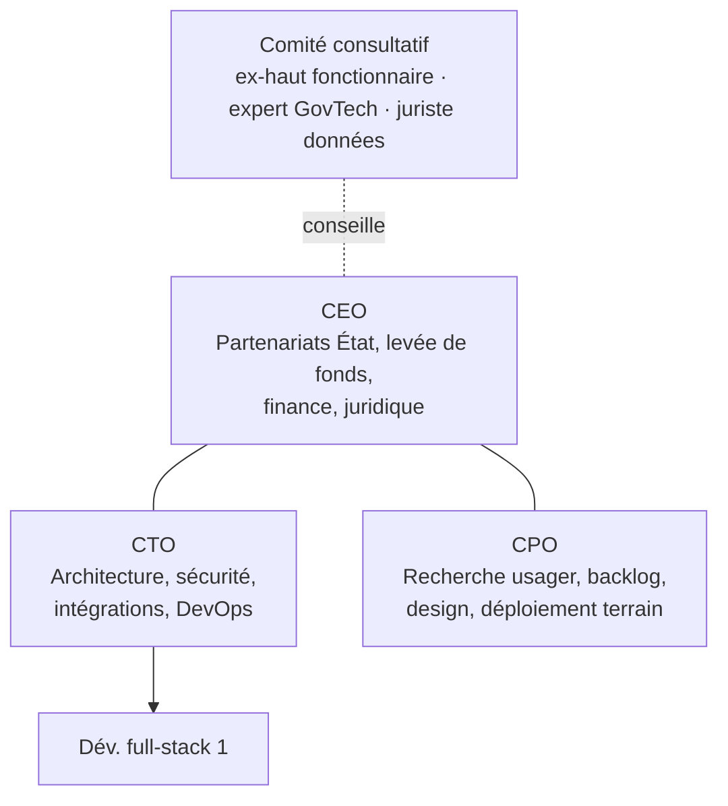
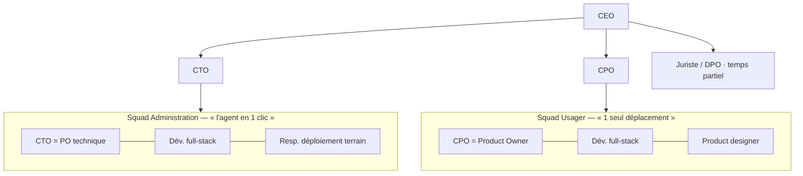
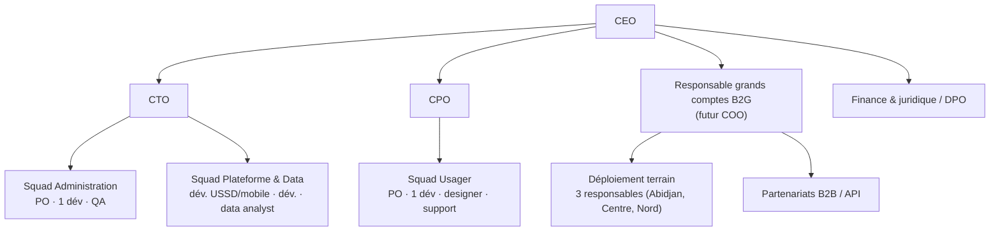

# 10 — Organisation de la startup SUIVO

Critère du jury servi : **qualité de l'équipe**, crédibilité de l'exécution.

Cette structure reprend ce qui marche dans les meilleures startups et l'adapte à une équipe naissante de 3 fondateurs :
**Amazon** (équipes « deux pizzas », mémo écrit avant chaque décision importante), **Spotify** (squads autonomes par mission), **Stripe** (culture de l'écrit, exigence de qualité), **Netflix** (liberté et responsabilité, contexte plutôt que contrôle), **Y Combinator** (« make something people want », parler aux utilisateurs chaque semaine), **Basecamp/Shape Up** (cycles courts avec un périmètre fixe).

## 1. Mission, vision, valeurs

- **Mission** : supprimer les déplacements inutiles entre le citoyen et son administration.
- **Vision** : devenir la couche de traçabilité standard des services publics en Afrique de l'Ouest.
- **Valeurs** (chacune avec un comportement observable) :

| Valeur | Ce que cela veut dire en pratique |
|---|---|
| **Usager d'abord, agent aussi** | Chaque membre de l'équipe passe 1 demi-journée par mois devant un guichet, avec les usagers et les agents. |
| **Mesurer, pas supposer** | Toute décision produit s'appuie sur une donnée ou sur une hypothèse écrite avec son test. |
| **Écrire pour décider** | Les décisions importantes passent par un mémo de 1 à 2 pages, lu en silence en début de réunion. |
| **Intégrité sans compromis** | Aucun « arrangement », zéro tolérance pour la corruption : c'est notre produit. |
| **Liberté et responsabilité** | Chacun décide dans son périmètre ; on partage le contexte, on ne contrôle pas. |
| **Sobriété** | Économe en argent, en données mobiles et en complexité. |

## 2. Organigramme à 3 horizons

### Aujourd'hui (mois 0–6) : 3 fondateurs + 1 développeur

### Mois 12 : 8 personnes, 2 squads

### Mois 36 : 17 personnes, 3 squads + 2 fonctions transverses

**Règles d'organisation**
- Une squad = **une mission mesurable** (une métrique d'entrée de la North Star), au maximum 7 personnes et autonome de bout en bout (« you build it, you run it »).
- Chaque squad a un **Product Owner unique** qui décide du *quoi* ; l'équipe décide du *comment*.
- Les fonctions transverses (terrain, données, sécurité) sont des **services internes** au service des squads.
- On ne crée pas de niveau hiérarchique tant que l'équipe compte moins de 25 personnes.

## 3. Rôles et responsabilités des fondateurs

| Rôle | Responsable de (A) | Métrique principale | Décide seul |
|---|---|---|---|
| **CEO** | Conventions avec l'État et les communes, levée de fonds, trésorerie, recrutement des responsables, image publique | Nombre d'administrations signées ; mois de trésorerie disponibles | Prix, partenariats, embauches hors tech |
| **CTO** | Plateforme, disponibilité, sécurité, intégrations, qualité du code, recrutement tech | Disponibilité ≥ 99,5 % ; délai de déploiement | Architecture, outils, priorités techniques |
| **CPO** | Découverte produit, backlog, design, adoption par usagers et agents, formation | **North Star : déplacements évités / mois** ; % d'étapes mises à jour sous 24 h | Priorisation du backlog, roadmap trimestrielle |

Les décisions irréversibles (levée de fonds, pivot, contrat > 50 M FCFA, embauche d'un dirigeant) se prennent **à l'unanimité des fondateurs**, après un mémo écrit.

## 4. Gouvernance et cadre juridique

| Sujet | Choix recommandé |
|---|---|
| Forme juridique | **SAS** (droit OHADA, Acte uniforme sur les sociétés commerciales), souple pour accueillir des investisseurs |
| Création | Guichet unique du **CEPICI** : statuts, immatriculation au RCCM, déclaration fiscale et sociale (CNPS) |
| Capital initial | 1 à 5 M FCFA, libéré par les fondateurs |
| Répartition | Égalitaire ou quasi égalitaire entre les 3 fondateurs (par ex. 34 / 33 / 33), **10 % réservés** à un pool pour les salariés clés |
| Vesting | **4 ans avec 1 an de cliff**, inscrit dans le pacte d'associés (clauses de good leaver / bad leaver) |
| Pacte d'associés | Préemption, inaliénabilité 2 ans, sortie conjointe, non-concurrence, propriété intellectuelle cédée à la société |
| Instrument d'amorçage | BSA-AIR ou SAFE adapté au droit OHADA, ou augmentation de capital avec valorisation |
| Conformité données | Déclaration auprès de l'**ARTCI** (loi 2013-450), registre des traitements, DPO désigné |
| Instances | Comité de direction hebdomadaire ; comité stratégique trimestriel avec le comité consultatif puis les investisseurs |
| Marchés publics | Veille, références issues du pilote, partenariats avec des intégrateurs déjà référencés |

## 5. Rituels (cadence de fonctionnement)

| Fréquence | Rituel | Durée | Objet |
|---|---|---|---|
| Quotidien | Point de squad | 15 min | Obstacles, coordination |
| Hebdomadaire | Revue des métriques | 30 min | North Star, adoption agents, incidents |
| Hebdomadaire | **Parler aux utilisateurs** | 2 h | Au moins 5 échanges usagers ou agents par semaine (règle YC) |
| Toutes les 2 semaines | Sprint review + rétrospective | 1 h 30 | Démo de ce qui est réellement déployé |
| Mensuel | Revue terrain avec les agents champions | 2 h | Retours, priorisation, reconnaissance |
| Mensuel | Lettre aux parties prenantes | écrit | Chiffres, avancées, demandes d'aide (investisseurs, sponsor) |
| Trimestriel | Planification OKR | ½ journée | Objectifs et paris du trimestre |
| Trimestriel | Revue de sécurité et de conformité | 2 h | Accès, sauvegardes, ARTCI |

**Outils** : dépôt Git + CI ; tableau de backlog ; un wiki unique comme source de vérité (mémos, décisions, procédures) ; messagerie d'équipe ; tableau de bord des métriques produit.

## 6. OKR du premier trimestre

**O1 — Prouver que le problème est réel et chiffré**
- KR1 : 30 entretiens usagers et 10 entretiens agents réalisés et synthétisés
- KR2 : 200 questionnaires collectés devant 5 mairies
- KR3 : médiane du nombre de déplacements par démarche mesurée et publiée

**O2 — Signer le pilote**
- KR1 : lettre d'intention signée par 1 commune et 1 tribunal
- KR2 : 3 procédures modélisées et validées par les chefs de service
- KR3 : sponsor identifié au ministère de tutelle

**O3 — Rendre le MVP prêt pour le terrain**
- KR1 : passerelle SMS réelle branchée, 100 % des notifications livrées
- KR2 : test d'utilisabilité avec un SUS ≥ 75 et ≥ 85 % de réussite des tâches
- KR3 : une action agent réalisée en moins de 10 s, chronométrée sur le terrain

## 7. Plan de recrutement (aligné sur le modèle financier)

| Mois | Recrutement | Pourquoi à ce moment |
|---|---|---|
| 4 | Dév. full-stack 1 | Pré-amorçage obtenu, durcissement du MVP |
| 7 | Dév. full-stack 2, product designer, responsable terrain 1 | Lancement des communes payantes |
| 10 | Juriste / DPO (temps partiel) | Volume de données personnelles croissant |
| 13 | Responsable grands comptes B2G, responsable terrain 2 | Premier organisme national |
| 16 | Dév. 3, QA | Après la levée d'amorçage : qualité et vitesse |
| 19 | Data analyst, support usager | Lancement de l'API B2B, estimation des délais |
| 25 | Dév. mobile/USSD, terrain 3, partenariats B2B | Intérieur du pays, inclusion, diversification |

**Processus de recrutement** : fiche de poste rédigée comme un mémo (mission, résultats attendus à 6 mois) → exercice pratique rémunéré → entretien sur les valeurs → prise de références. Chaque fondateur peut opposer un veto.

## 8. Culture de la performance
- **Objectifs clairs** : chacun connaît la métrique qu'il fait bouger.
- **Rémunération** : salaire de marché après la levée, plus une participation au capital via le pool de 10 % (vesting 4 ans).
- **Développement** : budget formation annuel, mentorat par le comité consultatif, rotation possible entre squads.
- **Feedback** : entretien individuel toutes les 2 semaines ; revue à 360° tous les 6 mois.
- **Diversité et ancrage local** : recruter en priorité des talents ivoiriens, y compris dans les régions ; parité visée dans les postes à responsabilité.

## Risques & hypothèses critiques
- **Dépendance aux fondateurs** pour la relation avec l'État → documentation, binôme CEO + responsable B2G dès le mois 13.
- **Recrutement tech compétitif à Abidjan** → pool d'actions, mission à impact, partenariats avec des écoles (stagiaires).

## Prochaine action en 48 h
Signer une charte entre fondateurs (rôles, répartition provisoire, vesting) en attendant le pacte d'associés, puis ouvrir le dossier de création de la SAS au CEPICI.
