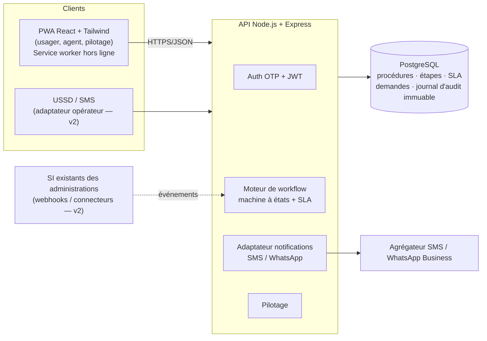

# MVP SUIVO — React + Tailwind (PWA) · Node.js + Express · PostgreSQL

Critère du jury servi : **faisabilité technique et démonstration**.
Le MVP couvre toutes les user stories *Must* du backlog (US-01 à US-18) ainsi que la PWA hors ligne (US-21).

## Lancer la démo

**Option 1 — Docker (une commande)**
```bash
cd jnsp-sprint-digital/mvp
docker compose up
# → http://localhost:5173
```

**Option 2 — Local** (Node ≥ 20, PostgreSQL ≥ 14)
```bash
# 1. Base de données
createuser -s suivo && createdb -O suivo suivo   # mot de passe : suivo (ou définir DATABASE_URL)
# 2. API
cd backend && npm install && npm run db:init && npm start      # http://localhost:4000
# 3. Web (dans un autre terminal)
cd frontend && npm install && npm run dev                      # http://localhost:5173
```

`npm run db:init` recrée le schéma, le référentiel (services, procédures, SLA) et 63 dossiers de démonstration fictifs.

### Comptes de démonstration (connexion par OTP ; en mode démo le code s'affiche à l'écran)

| Téléphone | Rôle | Pour montrer |
|---|---|---|
| `0700000001` | Usager — Awa Koné, représentante légale de ses jeunes frères | Mes dossiers : capital décès en retard (relance), acte de naissance prêt, titre foncier avec pièce manquante |
| `0700000020` | Agent — Guichet de la Fonction publique | Réception des demandes de capital décès |
| `0700000021` | Agent — Liquidation des droits | File de travail, validation, pièce manquante |
| `0700000022` | Agent — Service des paiements (Trésor) | Mise en paiement (dernière étape → « Prêt ») |
| `0700000040` / `41` / `42` | Agents — Guichet unique du foncier / Cadastre / Conservation foncière | Titre foncier et état foncier |
| `0700000010` | Agent — État civil (mairie) | Dépôt au guichet + reçu QR |
| `0700000099` | Admin — Pilotage | Tableau de bord des délais |

Démarches de démonstration : **capital décès** (orphelins d'un fonctionnaire décédé), **création de titre foncier**, **demande d'état foncier**, extrait d'acte de naissance, permis de construire. Les intitulés de services sont génériques, à remplacer par les intitulés officiels des administrations pilotes.

Suivi public sans compte : `http://localhost:5173/suivi/SUI-2026-000001`

### Scénario de démo pour le jury (3 minutes)
1. **Suivi public** du dossier de capital décès `SUI-2026-000001` : étape 2/3 « Liquidation des droits », service responsable, **en retard**.
2. Connexion **Awa** → *Mes dossiers* → elle **relance** le dossier en retard ; elle **répond** à la pièce manquante de son dossier de titre foncier sans se déplacer.
3. Connexion **agent de la liquidation des droits** → le dossier relancé est en tête de file, en rouge → **Valider l'étape** (1 clic) → Awa est notifiée.
4. Connexion **agent état civil** → *Dépôt guichet* pour un usager sans smartphone → **reçu avec QR**.
5. Connexion **admin** → *Pilotage* : déplacements évités, retards par service, délai réel vs prévu.

Les SMS sont simulés : ils sont écrits dans la table `notifications` et dans la console de l'API.

## Architecture



### Modèle de données
`services` → `etapes` (ordre, service responsable, SLA en jours ouvrés) ← `procedures`
`utilisateurs` (usager / agent rattaché à un service / admin) → `demandes` (numéro `SUI-AAAA-NNNNNN`, étape courante, statut, échéance de l'étape, SLA suspendu) → `evenements` (journal d'audit **immuable** grâce à un trigger) et `notifications`.
Voir [`backend/db/schema.sql`](./backend/db/schema.sql).

### Règles métier implémentées
- Machine à états : `SOUMIS → EN_COURS → (ATTENTE_USAGER ↔ EN_COURS) → PRET → RETIRE`, `REJETE` avec motif obligatoire.
- Un agent n'agit que sur les dossiers dont l'étape courante appartient à **son service** ; le retrait se fait au guichet de dépôt.
- SLA en **jours ouvrés** ; niveau vert / orange (< 20 % du temps restant) / rouge (dépassé).
- Pièce manquante : **SLA suspendu**, temps restant conservé puis restitué à la réponse de l'usager.
- Relance usager : seulement si le délai de l'étape est dépassé, **1 fois / 48 h**.
- Suivi public : nom masqué (initiales), aucune donnée de contact.
- OTP : code à 6 chiffres haché (SHA-256), valable 5 min, 5 essais max.
- Chaque validation d'étape enregistre si le SLA a été respecté → indicateurs de pilotage.

### API REST

| Méthode | Route | Rôle | Description |
|---|---|---|---|
| POST | `/api/auth/otp` | public | Envoie un code (renvoyé en mode démo) |
| POST | `/api/auth/verifier` | public | Vérifie le code → JWT |
| GET | `/api/moi` | connecté | Profil |
| GET | `/api/procedures` | public | Catalogue avec étapes, SLA, délai total |
| GET | `/api/suivi/:numero` | public | Suivi anonymisé |
| GET / POST | `/api/demandes` | usager | Mes dossiers / déposer |
| GET | `/api/demandes/:numero` | propriétaire, agent | Détail complet + historique |
| POST | `/api/demandes/:numero/repondre` | propriétaire | Réponse à une pièce manquante |
| POST | `/api/demandes/:numero/relancer` | propriétaire | Relance (si retard) |
| GET | `/api/agent/file` | agent | File du service triée par urgence |
| POST | `/api/agent/demandes/:numero/valider` | agent | Valide l'étape → étape suivante ou « Prêt » |
| POST | `/api/agent/demandes/:numero/piece-manquante` | agent | `{ message }` |
| POST | `/api/agent/demandes/:numero/rejeter` | agent | `{ motif }` |
| POST | `/api/agent/demandes/:numero/remettre` | agent du guichet | Clôture |
| POST | `/api/agent/guichet` | agent | Dépôt pour un usager `{ telephone, nom, procedure_id }` |
| GET | `/api/stats` | agent, admin | Indicateurs de pilotage |

### Tests
```bash
createdb -O suivo suivo_test
cd backend && npm test
```
7 scénarios de bout en bout (OTP, catalogue, parcours complet avec pièce manquante, relance, rejet, guichet, journal immuable, droits d'accès, statistiques). Le parcours complet a aussi été joué dans un navigateur headless : voir les captures dans [`../assets/captures`](../assets/captures).

## Passer en production (feuille de route technique)
1. Passerelle SMS/WhatsApp réelle (adaptateur `src/notify.js`), `DEMO_MODE=false`, secret JWT fort.
2. Tâche planifiée d'alertes et d'escalade (US-15) ; canal USSD (US-19).
3. Webhooks entrants pour les plateformes de dépôt existantes ; API B2B avec consentement.
4. Hébergement souverain, sauvegardes, supervision, tests de charge, audit de sécurité, déclaration ARTCI.

## Risques & hypothèses critiques
1. **SMS simulés** : les notifications ne partent pas encore réellement. *Action* : brancher un agrégateur SMS dans `src/notify.js`.
2. **Pas encore prêt pour la production** : il manque la tâche planifiée d'escalade (US-15), la limitation du débit des requêtes OTP, un audit de sécurité, la supervision et les sauvegardes. Le MVP sert à la démonstration et au pilote encadré.
3. **Mode démo** : le code OTP est renvoyé par l'API. Il faut impérativement mettre `DEMO_MODE=false` hors démonstration.

## Prochaine action en 48 h
Déployer le MVP sur un hébergement accessible publiquement (avec une URL de démo) et faire tourner le scénario de démo du jury sur un téléphone Android d'entrée de gamme en 3G.
